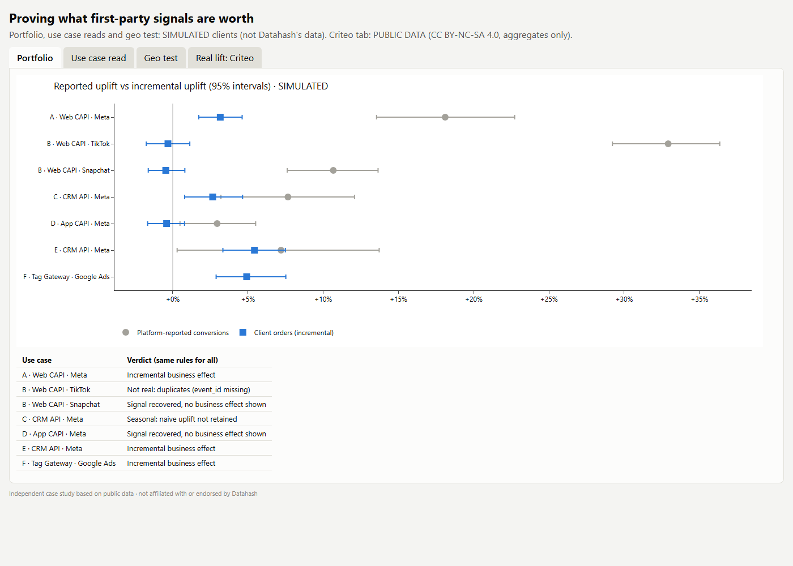

# Datahash: proving what first-party signals are worth, without fooling ourselves

Public data on Datahash and a real randomised ad-incrementality test (Criteo), plus a simulated, calibrated
multi-client panel, turned into a measurement playbook per use case, causal-impact and geo-experiment reads,
client-ready impact reports and a shared evidence standard.

> Independent case study based on public data · not affiliated with or endorsed by Datahash.
> **PUBLIC DATA** = Datahash's own pages and the Criteo dataset. **SIMULATED** = six fictional clients; never
> Datahash's data or any client's data.

## Deliverables

| | |
|---|---|
| **Report (8 pages, PDF)** | [docs/Datahash_Measurement_CaseStudy.pdf](docs/Datahash_Measurement_CaseStudy.pdf) |
| **Interactive dashboard** (self-contained HTML, open in a browser) | [dashboard/measurement_dashboard.html](dashboard/measurement_dashboard.html) |
| **Analysis tracker, pre/post calculator, lift power, evidence checklist** (Excel, live formulas) | [excel/analysis_tracker.xlsx](excel/analysis_tracker.xlsx) |
| **Client deliverables** (SIMULATED clients A and E): impact report, renewal one-pager, case study with "How we measured it" | [deliverables/](deliverables/) |
| **Measurement playbook** per use case and platform | [docs/MEASUREMENT_PLAYBOOK.md](docs/MEASUREMENT_PLAYBOOK.md) |
| **Evidence standard and quality checklist** | [docs/EVIDENCE_STANDARD.md](docs/EVIDENCE_STANDARD.md) |
| **Reading a platform lift study** · **Glossary** | [docs/PLATFORM_LIFT_GUIDE.md](docs/PLATFORM_LIFT_GUIDE.md) · [docs/GLOSSARY.md](docs/GLOSSARY.md) |
| **Notebook** (all methods, explained) | [notebooks/measurement.ipynb](notebooks/measurement.ipynb) |

## Key results

1. **Exposed is not incremental (PUBLIC DATA, Criteo, ~14 million users).** The randomised lift is +59% conversions
   (95% CI +54% to +65%); for the 3.6% of users actually reached it is +146%. Comparing exposed with unexposed users
   gives ×45, about 30 times the real effect: ads reach users who would have converted anyway.
2. **Signal recovered is not value (SIMULATED).** Web CAPI on Meta raised platform-reported conversions by +18% but
   client orders by +3.2% (95% +1.7% to +4.6%) against an untouched control market. Both are reported, separately.
3. **Eight planted traps, eight caught (SIMULATED)** with rules written before the read: broken deduplication
   (+33% of duplicates), a Ramadan read window, an attribution-window change, the click-date lag, a learning-phase
   ramp-up, an EMQ jump with no business effect, a geo effect (+4.9% bookings, 95% +2.9% to +7.5%, synthetic control).
4. **Datahash's published stories (PUBLIC DATA, 16 case studies, not named).** 13 of 16 give a quantified outcome;
   a shared evidence template would add the baseline (2 of 16 today), the before/after window (6), a comparison
   group (2), the attribution setting (0) and an interval (0).



## Methods

- **SQL** (DuckDB, CTEs and window functions): Criteo lift aggregates, pre/post with baseline, ramp-up exclusion,
  control market and same weeks last year, deduplication health, attribution-setting changes, click vs conversion
  date, geo-test preparation ([sql/](sql/)).
- **Randomised test**: intention-to-treat lift with a delta-method interval, effect on the exposed (Wald estimator),
  selection check, power for a lift study.
- **Causal impact**: structural time series (`statsmodels` `UnobservedComponents`, local level) on the weekly ratio
  treated / control market, one-market holidays as a regressor, 1,000 simulated counterfactual paths, in-time
  placebos; a persistence read when the window is dominated by a seasonal peak.
- **Geo test**: synthetic control (non-negative weights summing to 1, SLSQP), 300 placebo groups, an in-time
  placebo, minimum detectable effect planned from the pre-period.
- **Reporting automation**: a fact sheet per analysis, drafts from sentence templates (an optional LLM draft can
  rephrase them), and a number checker that rejects any figure it cannot trace, tested on trap errors (ROAS vs CPA,
  percent vs points, wrong window, health metric sold as value, wrong sign).
- AI-assisted workflow: I used Claude, mainly to write scripts faster. I drove the project: I defined the questions, chose and validated the data sources, made the analytical decisions and checked every result.

## How to re-run

```bash
python -m venv .venv && .venv/Scripts/activate        # Windows; use bin/activate elsewhere
pip install -r requirements.txt
python src/fetch_public.py      # Datahash pages, once, robots.txt respected (network; raw pages are not in the repo)
python src/parse_public.py      # facts + anonymised case-study grid
python src/extract_criteo.py    # downloads Criteo v2.1 (311 MB, not in the repo), writes aggregates only
python src/simulate.py          # SIMULATED panel, seed 42
python src/run_sql.py           # sql/02-05
python src/analysis.py          # every number of the study -> data/output/
python src/report_writer.py     # client deliverables, every number checked
pytest                          # trap tests of the number checker
python src/build_notebook.py    # executes notebooks/measurement.ipynb
python src/build_excel.py
python src/build_dashboard.py
python src/build_pdf.py         # needs Microsoft Edge or Chrome (headless print)
```

Everything runs without any API key. The processed data (`data/processed/`, `data/output/`) is in the repository, so
the steps from `simulate.py` onward also run offline.

## Sources and licences

| Data | Source | Licence / terms |
|---|---|---|
| Datahash pages and 16 case studies | https://www.datahash.com, read 18 Nov 2026 | Public pages, quoted "as stated by Datahash"; brands, people and headline figures of the case studies are not reproduced |
| Criteo Uplift Prediction Dataset v2.1 | https://huggingface.co/datasets/criteo/criteo-uplift | **CC BY-NC-SA 4.0**: non-commercial use, attribution, share-alike; only aggregates are published |
| Platform documentation | Meta, Google, Snapchat, TikTok (links in [docs/PLATFORM_LIFT_GUIDE.md](docs/PLATFORM_LIFT_GUIDE.md)) | Cited and summarised |
| Simulated panel | [src/simulate.py](src/simulate.py), assumptions in [data/ASSUMPTIONS.md](data/ASSUMPTIONS.md) | Fictional |

Details: [data/SOURCES.md](data/SOURCES.md).

## Limits

- The panel is simulated: it demonstrates the method and the traps, not Datahash's results or any client's.
- The case-study grid codes what is *published*, not what was measured behind each story.
- Criteo is display retargeting over one period: the size of its lift does not transfer to CAPI, the logic does.
- Causal impact assumes an untouched control market sharing the calendar; geo tests assume no spill-over between
  regions. Both are checked with placebos, not proven.
- No access to ad accounts: platform behaviour comes from public documentation.

## Repository

```
src/         collection, simulation, analysis, charts, deliverables, checker, builders
sql/         DuckDB queries (01 Criteo, 02-05 simulated panel)
data/        SOURCES.md, ASSUMPTIONS.md, processed/ (parquet, csv), output/ (results)
notebooks/   measurement.ipynb
docs/        report PDF, playbook, evidence standard, lift guide, glossary, charts
deliverables/ client_a, client_e (SIMULATED): facts.json, impact report, one-pager, case study (md, html, pdf)
excel/       analysis_tracker.xlsx
dashboard/   measurement_dashboard.html
tests/       test_check_numbers.py
```
